# Infinity / Xalaria 0.10.0

A native C++20 exploration prototype combining **Xalaria's published universe and wormhole map** with **your existing Infinity flight engine and Hyperion/Metal renderer**.

Download [Infinity / Xalaria 0.10.0 for macOS](https://github.com/maetyu-d/infinity_xal/releases/tag/v0.10.0). Unzip the download and open **Infinity Xalaria.app**. The macOS 26+ arm64 app runs offline with the engine built in.

The 82 occupied regions have four looks. **Charred Glass** covers 22 regions. **Verdant Fog**, **Tidal Blue**, and **Acid Etch** cover 20 each. The atlas shows the selected region's look, and the flight view blends to it as you enter. Oylanhai has the charred palette, Ziksa has green haze, and Phiat has dark, white-capped currents suspended among the stars. The currents stay in place as the ship rolls. Search for Eudaya to see Acid Etch, with hot pink skies, sulphur-yellow mineral crust, and pitted slate surfaces.

Warp now uses ember speed streaks and a soft fade around the destination. The petal-shaped rings are removed from the tunnel, entry and exit.

## Graphics upgrade

- Charred Glass has layered dust lanes and refracting sheets. Verdant Fog has thicker cloud banks with lit edges. Tidal Blue has finer foam and reflections on currents that stay in place as the ship rolls. Acid Etch has mottled pink and sulphur-yellow deposits.
- Planet surfaces have more visible erosion, mineral deposits, and dark crust around molten areas. Atmospheric haze, high-altitude scattering, and stellar discs resolve against the actual scene depth.
- Stations have braced decks, stacked hulls, and radiator fins. The Oylanhai–Ziksa wormhole has an animated plasma rim and a dark, textured throat.
- The windscreen and side panes reflect the cabin lights. Rubber, brushed metal, painted panels, and bronze trim respond differently to light. Direct stellar light is filtered by the canopy openings.

## Cockpit

Hold **Shift** and move the mouse to look through the side windows, up at the overhead panel, down at the controls, or back toward the hatch. Release **Shift** to face forward. The heads-up display fades as you turn away from the windscreen. The windows carry the light of each system onto the painted alloy and rubber trim.

- The yoke follows the ship's pitch, yaw, and roll. The port throttle lever slides as you change thrust with **W** and **S**.
- The forward display shows velocity and either altitude or stopping distance. The port console shows throttle and fuel. The starboard scope shows the selected target's bearing and range alongside hull integrity.
- The overhead panel shows landing gear, flight assist, and docking status.

[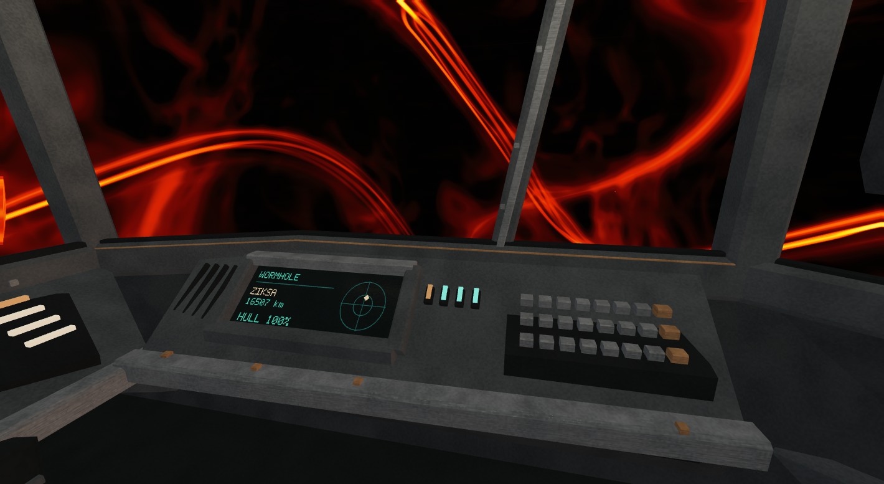](Previews/Cockpit.png)

## Planets and stars by environment

Select any screenshot to open it at full size.

| Environment | Planet | Local star |
| --- | --- | --- |
| **Charred Glass** Oylanhai | [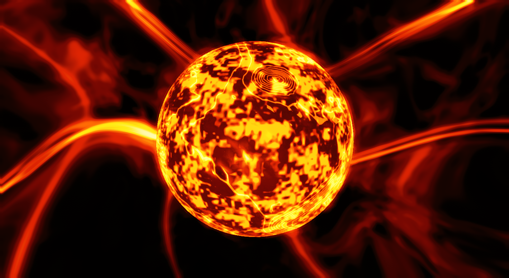](Previews/Charred-Planet.png) | [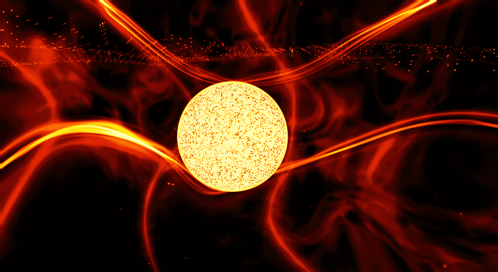](Previews/Charred-Star.png) |
| **Verdant Fog** Ziksa | [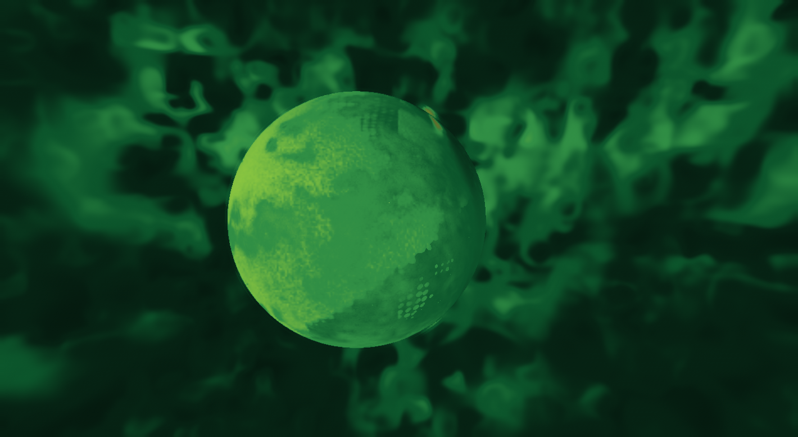](Previews/Verdant-Planet.png) | [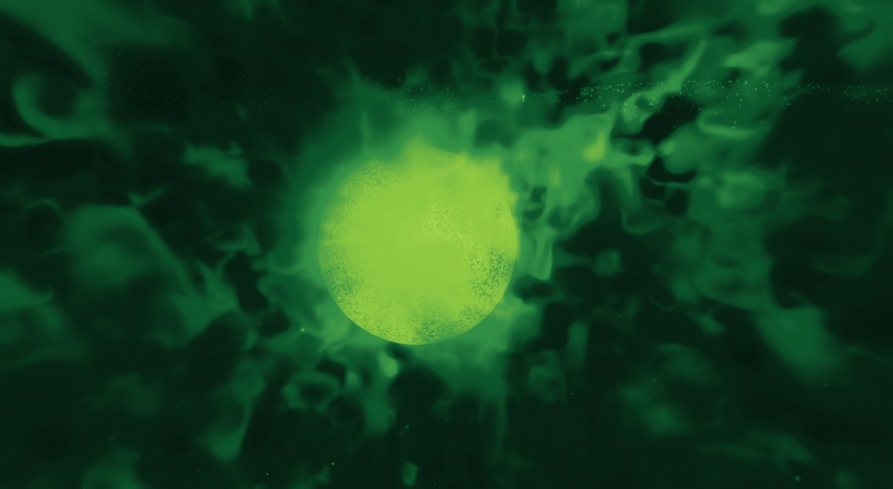](Previews/Verdant-Star.png) |
| **Tidal Blue** Phiat |  | [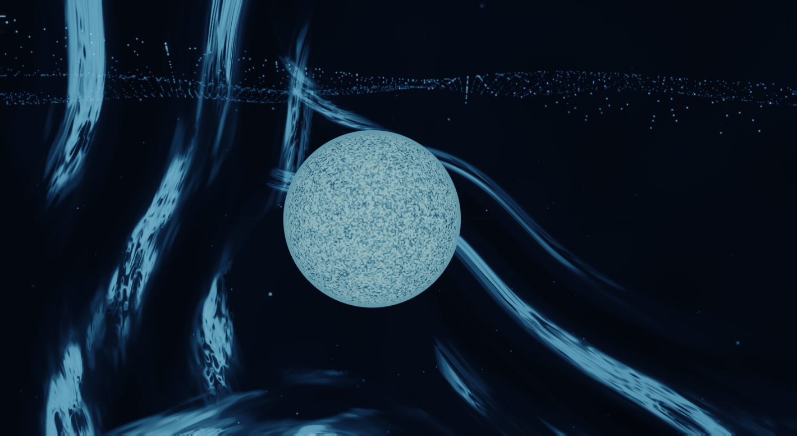](Previews/Tidal-Star.png) |
| **Acid Etch** Eudaya | [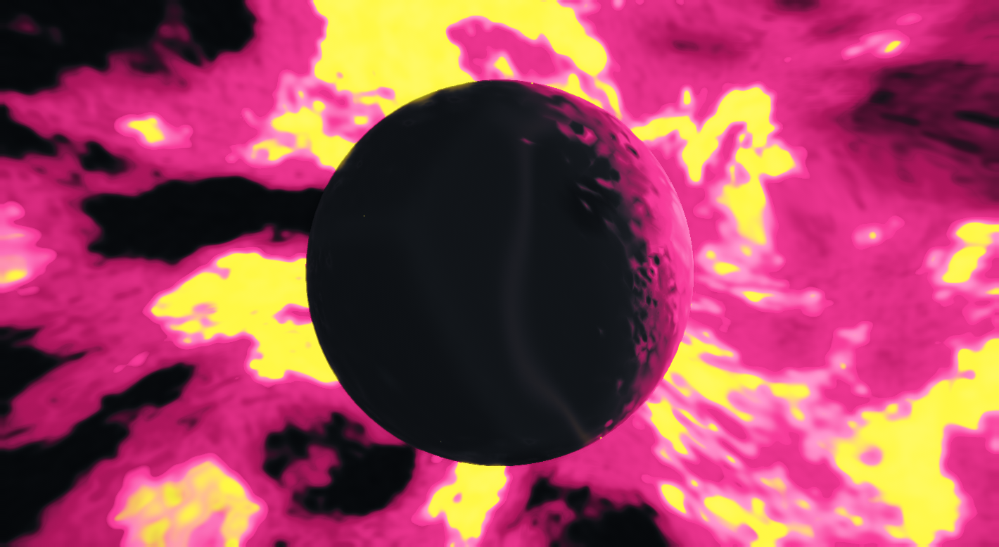](Previews/Acid-Orbit.png) | [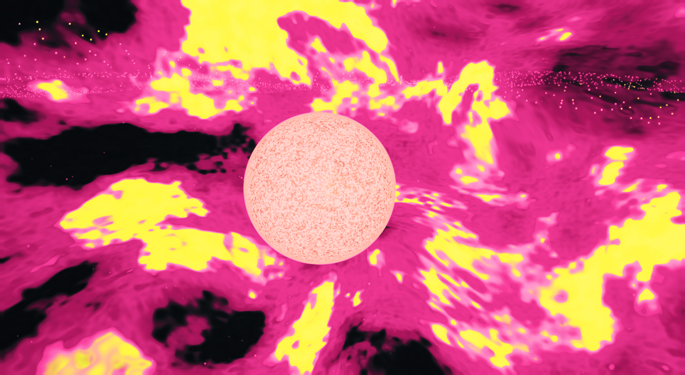](Previews/Acid-Star.png) |

## Photographic lens in 0.5

Bright stars, lamps and glass glints now spread into an eight-blade aperture bokeh, with compressed cat-eye shapes near the frame edges. A depth-aware focus pass keeps the central scene in focus and gently softens foreground and distant detail. Warm halation, subtle barrel distortion, edge dispersion and a visible-star flare chain add a photographic lens character. The charred reds, deep browns and burning yellow-white highlights remain.

The effect uses the live HDR image and depth. It adds no random light orbs. The physical cockpit, target markers and interface are drawn afterward and stay sharp. `--no-lens-effects` disables the new camera treatment for comparison.

## High-contrast glass space in 0.4.1

Deep umber and crimson now sit farther below the incandescent yellow-white highlights. Space itself carries exaggerated curved glass sheets, dark reflective bodies, sharp bevel light and nested caustics. The sky is anchored to celestial directions; a depth-masked optical pass refracts the live background and adds a weaker second-surface image. Planets, stations and HUD geometry keep their positions.

This is an artistic optical material for the void. It adds no stars, world objects or collision boundaries. `--no-glass-space` disables the space effect for comparison. `--space-test --fresh --smoke-test` places a separate capture profile in open space.

## Glass and mirrors

Stations and settlements use painted alloy, glazed panels, concrete and their own fixture colours. Regional light falls on these finishes and appears in polished reflections. Pane interiors, panel joints and wear follow the structure. Planet surfaces, skies and haze carry the stronger regional palettes.

Reflections use current-frame scene colour, depth and material normals. They fade near the screen edges and fall back to a directional environment when the reflected object is outside the view. This is screen-space reflection with an environment fallback; it is not ray tracing. Reflection strength varies by surface and viewing angle, with roughness filtering to reduce distant sparkle. HUD text remains outside the reflection pass.

### Stations and settlements

| **Eunhia Station** · Charred Glass | **Phehmyar Station** · Verdant Fog |
| --- | --- |
| [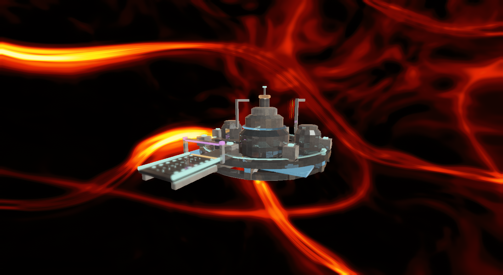](Previews/Glass-Station.png) | [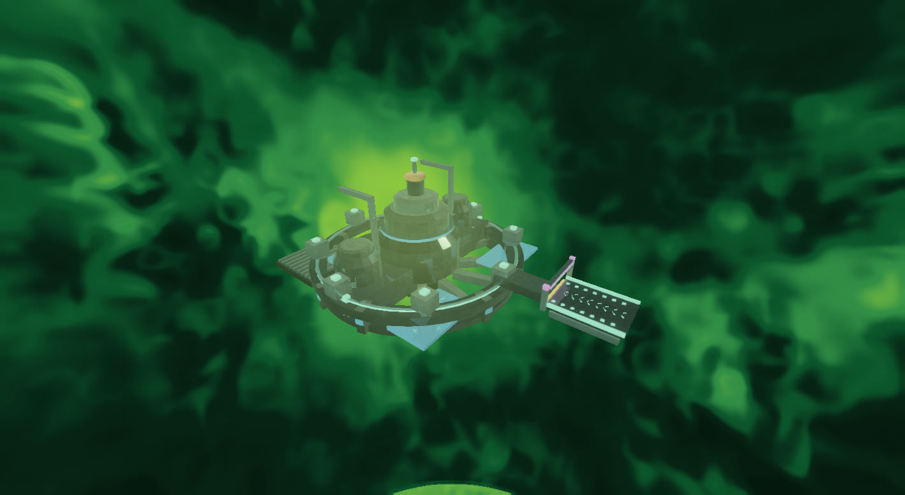](Previews/Verdant-Station.png) |
| **Mroyrn Station** · Tidal Blue | **Yugve Station** · Acid Etch |
| [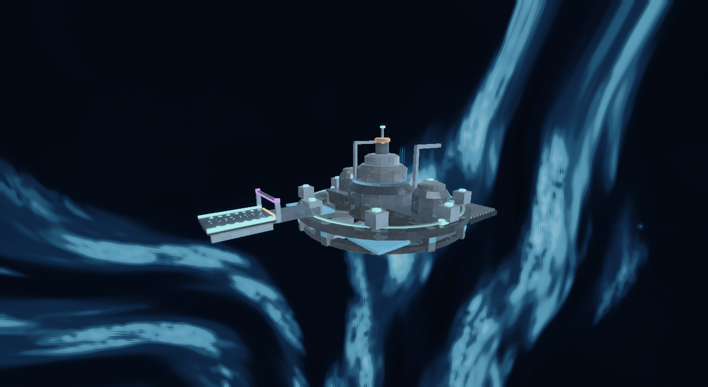](Previews/Tidal-Station.png) | [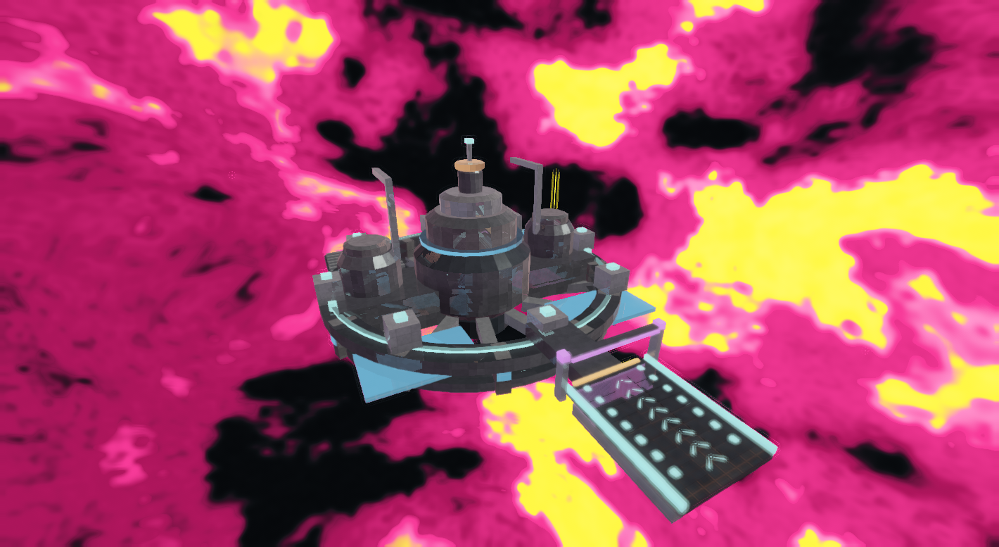](Previews/Acid-Station.png) |
| **Phehmyar** · Surface city | **Iakay** · Surface city |
| [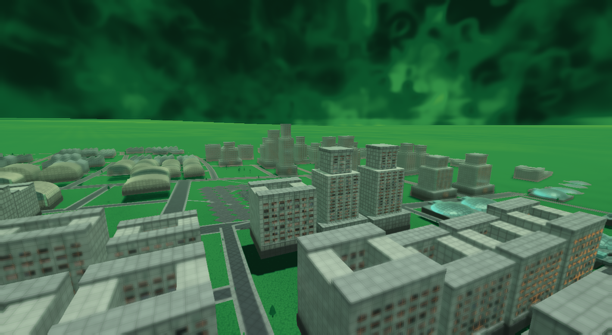](Previews/Phehmyar-City.png) | [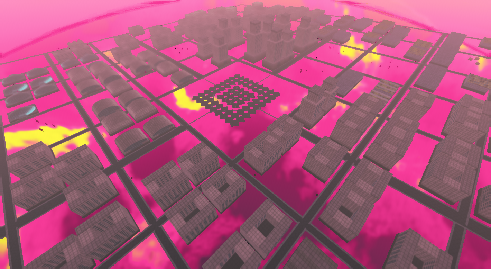](Previews/Iakay-City.png) |

## Firelight colour scheme

The two supplied fire photographs define the palette: near-black silhouettes, blackened wine and crimson shadows, saturated flame orange, amber light and isolated yellow-white heat. The materials, atmosphere, warp, physical cockpit, map and economy screens share it. Hot emission retains its brighter range, while ordinary surfaces keep dark edges and texture contrast.

The reference swatches are recorded in [data/firelight-palette.json](data/firelight-palette.json). The photographs were used for colour direction; they are not included in the package.

## Economy in 0.3

Press **F4** or **Trade** on the atlas to open markets, holdings, mining, services and delivery charters.

- Buy and sell twelve verified bulk goods at physical stations and city exchanges. Carry cargo to other stars, compare profitable routes, refuel and exchange for larger holds.
- Mine finite surface deposits with fitted tools, then sell or build with their output.
- Seed and feed stations, private storage vaults and farms. Collect their tills, hire city guards, add vault fuel and build cultural halls.
- Earn Trade goodwill and rebates; learn local aesthetics and donate authentic ornaments to galleries.
- Fuel, cargo mass, docking and wormhole navigation share the real ship. Remote markets are read-only previews.
- Economic time and holdings continue while away. Ship, route, wallet, cargo and economy save in one atomic checkpoint.

The rules use Xalaria's public handbook, with documented local balance where the live server data is unavailable. This is an offline economy, not a connection to the live game. See [the economy guide and source distinctions](docs/ECONOMY.md).

## Map integration

### Fly the Oylanhai–Ziksa wormhole

- At Eunhia Station 1, press **F4** to trade and **D** on the station screen to release the clamps. Wait for the departure lane to hand you the helm.
- Press **H** in flight to target the wormhole. In the atlas, select **Ziksa** and choose **Target Wormhole** for the same bearing.
- Use the arrows or press **C** to steer with the mouse and line up with the ring. Increase thrust with **W**, reduce it with **S**, and fly through the centre. A crossing uses eight fuel.
- The exit puts you on approach to **Phehmyar Station 1**. Press **F4**, then **D** to request docking. Use **H** in Ziksa to find the return mouth.

[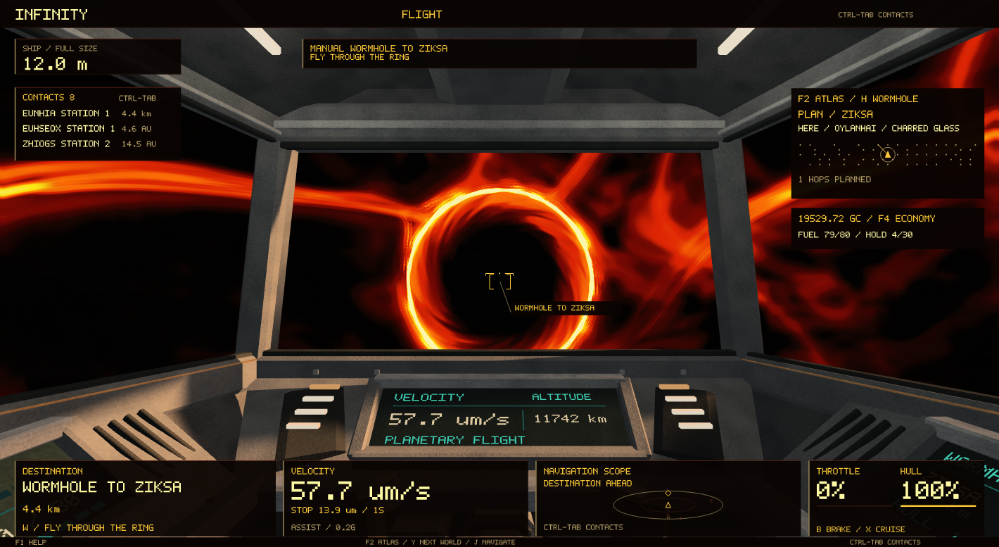](Previews/Manual-Wormhole.png)

- Switch between the galaxy and an orbital schematic with **F3** or the Galaxy/System buttons. Select planets and moons directly in the diagram or world list.
- The live ship marker comes from the same physical position as the flight engine. The cockpit has a clickable navigation card with a route minimap, destination, leg number, range and progress.
- The planned selection appears in rust; the committed course appears in amber. Browsing another star or world leaves the committed course intact. A selected world also supplies the cockpit target name and bearing.
- Use **Pause/Resume** or **Space** to retain a course while braking. **Cancel** or **B** returns to manual flight. Manual steering pauses a guided course.
- Journeys save with the ship, including the remaining hops, precise final world and pause state. Existing saves from 0.1 retain their current flight target.
- Drag the galaxy view to pan. Scrolling zooms around the cursor. **Locate**, **Fit Route** and **Overview** make it easy to recover the ship or see the whole plan.
- Search results are visible and ranked with exact names first. World searches select the matching world; Tab and Shift-Tab cycle results. A failed search cannot launch a stale destination.
- Double-click a star to inspect its system, or a world to fly to it.

## What is playable

- Search the actual public star and world names, select systems on a native map, inspect planets and moons, zoom and pan.
- Plot the shortest available route through the published **directed wormhole links**. Disconnected stars remain disconnected.
- Press Enter to fly each route leg with Infinity's existing guided warp, collision checks, acceleration, cockpit and destination reveal. The ship moves continuously; route selection does not teleport it.
- Select a world in the current system and press Enter to approach it. Use manual thrust, mouse steering, landing gear and automatic landing.
- Save and resume the ship and navigation state. Saves are separate from the original Infinity game.

The catalogue contains **7,710 stars, 48,081 planets and moons, 11,254 life-bearing worlds, and 6,041 communities**. These are counts from the downloaded explorer snapshot, fingerprint **5923cc4f**. Xalaria's homepage advertises different totals; this build follows the files actually served.

## Controls

| Context | Control | Action |
|---|---|---|
| Anywhere | F4 | Economy / trade |
| Anywhere | F2 | Map / flight |
| Anywhere | F3 | Galaxy / system view |
| Active journey | Space | Pause / resume |
| Atlas | Type a name or star ID | Search stars and worlds |
| Atlas | Tab / Shift-Tab | Next / previous search result |
| Atlas | Click | Select star or world |
| Atlas | Enter | Fly selected route or world |
| Atlas | Drag / arrows | Pan the galaxy map |
| Atlas | Scroll | Zoom at cursor; scroll worlds when over the list |
| Atlas | Locate / Fit Route / Overview | Frame ship / journey / galaxy |
| Atlas | Home | Centre on the live ship |
| Atlas | Page Up / Page Down | Scroll the world list |
| Flight | W A S D / Q E | Forward, sideways and vertical thrust |
| Flight | Arrows / Z V | Pitch, yaw and roll |
| Flight | C | Capture / release mouse steering |
| Flight | Hold Shift + move mouse | Look around the cockpit. Release Shift to face forward. |
| Flight | Left Option (Alt) / Ctrl | Boost / precision |
| Flight | B | Brake and cancel the queued route |
| Flight | X / scroll | Cruise / drive setting |
| Flight | Y / J | Next planet / approach selected planet |
| Flight | G / L | Landing gear / automatic landing |
| Flight | Ctrl-Tab | Contact catalogue |
| Flight | F1 | Controls |
| Flight | Escape | Release mouse, then exit |

Interstellar travel takes time: warp speed increases with clearance from nearby worlds and stars. Opening the atlas leaves the simulation running.

## What was recovered

The public explorer exposes a star index and 82 region files. The index supplies source IDs, names, spectral classes, technology and directed wormhole links. Region records supply stellar radius and temperature, primary and moon hierarchy, radii, orbital distances and periods, temperatures, solid/gas classification, life flags, community/station counts, cloud descriptors and ring bounds.

The native importer reads the compact factual snapshot in [data/catalog.tsv](data/catalog.tsv). Source distances and radii are converted to metres; periods to seconds. The public explorer's scale is retained: one logical map step represents **10^15 metres**.

The map uses Xalaria's logical 200 by 200 grid. Its gentle vertical lift is a presentation adaptation; Infinity provides the detailed surfaces, lighting, atmospheres, cockpit and warp imagery. Physical stellar mass is inferred from the published radius and temperature because the export does not supply mass. Worlds retain source temperatures and solid/gas classification. Ring bounds come from the export; detailed ring appearance is Infinity's.

This is an **offline flight and economy prototype**. It does not connect to Xalaria's game server or import its multiplayer state, accounts, text adventure, robot AI or live player holdings. The local economy and construction rules are described above; the full server economy is not reproduced. Community and station counts are inspectable facts; procedural settlements are Infinity scenery rather than imported city layouts. Source orbital periods are retained; the scene starts from a fixed reference epoch and is not synchronised to the live browser game's clock. Infinity's microscopic material model uses a representative material on worlds hotter than its supported solid phases.

## Build

The delivered macOS 26+ arm64 application is statically linked to the existing Infinity engine libraries. For rebuilding locally:

~~~sh
cmake -S . -B build -G Ninja \
  -DINFINITY_ENGINE_ROOT="/path/to/Infinite"
cmake --build build -j 3
cmake --build build --target test
./build/infinity_xalaria
~~~

Set INFINITY_ENGINE_BUILD if the engine's build directory differs. The CMake file currently targets macOS using your existing compiled libraries. Windows and Linux packages have not been built.

The new entry point is [src/XalariaMain.cpp](src/XalariaMain.cpp). Catalogue loading and graph routing are in [src/Xalaria.cpp](src/Xalaria.cpp). The economy ledger is [src/XalariaEconomy.cpp](src/XalariaEconomy.cpp), with its guide in [docs/ECONOMY.md](docs/ECONOMY.md). The shared journey controller is [src/XalariaNavigation.cpp](src/XalariaNavigation.cpp); projections and picking are in [src/XalariaMap.cpp](src/XalariaMap.cpp). The other changes adapt Universe, Geometry, Flight, Planetology, Cockpit and Renderer. The project embeds its own checked-in shaders and verifies their source/binary hashes when configuring; it does not reuse the original Infinity shader header. The copied Infinity source is included for inspection; CMake compiles the replacement modules and links the remaining existing engine library. No JavaScript or browser runs inside the game.

Infinity baseline: the existing local working tree, version 0.69.0, with HEAD ee5f9de7f16a748cc254db44490ea13db3349495 and its pre-existing uncommitted changes. Engine archive SHA-256: 817b9dae58128fec6a6b4ccb5f88152641e754a674e4f2f8f285b4e194c06a56. Rebuild against this matching engine baseline.

Verification checks catalogue totals, every star address, representative world descriptors, moon parentage, ring bounds, map text bounds, disconnected and directed routes, real ship movement, save restoration, galaxy samples and a complete interstellar arrival. The integration suite also verifies a two-hop journey, destination stability while browsing, pause/resume, route checkpoints, frame-invariant ship coordinates, map picking and cursor-centred zoom. The economy suite verifies physically authorised transactions, conservation, cargo limits, a wormhole cargo haul, fuel progress, sealed delivery, finite mining, construction, vaults, farm guards, cultural income, offline settlement, expiry, corrupt-save rejection and UI bounds. Native captures are in Previews.

## Sources and attribution

- [Xalaria universe explorer](https://www.xalaria.com/universe/)
- [Public star index](https://www.xalaria.com/universe/data/index.json)
- [Public data-loader schema](https://www.xalaria.com/universe/js/universe-data.js?v=7)
- [Public explorer scale and presentation](https://www.xalaria.com/universe/js/universe-app.js?v=82)
- [Public economy and construction handbook](https://www.xalaria.com/handbook/)
- [Xalaria homepage](https://www.xalaria.com/)

Xalaria and its original names and universe data are by **Julian Cochran**. Its public availability is not an open-source licence. No Xalaria JavaScript, narrative prose, music, artwork or server code is included in this source package. This is a local adaptation for the requested project, not an official Xalaria client.

The source snapshot's retrieval details and SHA-256 hashes are in [data/provenance.json](data/provenance.json). Infinity's existing dependency notices are in THIRD_PARTY.md and third_party_licenses.

Shader changes can be rebuilt with the matching engine's shader compiler:

~~~sh
python3 tools/compile_shaders.py \
  --shaderc "/path/to/Infinite/build/shader-tool/shaderc" \
  --bgfx-include "/path/to/Infinite/external/bgfx/src"
cmake --build build -j 3
~~~

To check scene reflections, capture the same saved berth and frame with and without `--no-reflections`, then run:

~~~sh
python3 tools/check_reflections.py --on reflection-on/flight.ppm --off reflection-off/flight.ppm
~~~

The comparison verifies a visible change on the floor while keeping the HUD unchanged. The additional normal/material buffer uses eight bytes per scene pixel; the reflected colour is traced against the existing current-frame depth buffer.

For the glass-space and contrast comparison, capture matching open-space views with and without `--no-glass-space`. `tools/check_space_glass.py` checks that the background changes while the HUD remains unchanged; it can also compare the dark and yellow ranges in matching before/after berth captures.

Lens verification uses matching native captures with and without `--no-lens-effects`. The optical composite remains HDR through bright-light extraction and a 48-tap aperture gather, then receives one final display transform. Autofocus samples the central depth cross; geometric defocus is capped at five pixels, while highlights use a wider iris. It is an artistic screen-space camera model. Transparent surfaces share their opaque depth, and there is no temporal focus history. The additional optical and reduced-resolution targets use about 9.8 bytes per scene pixel.

~~~sh
python3 tools/check_lens.py --on lens-on/flight.ppm --off lens-off/flight.ppm
~~~
